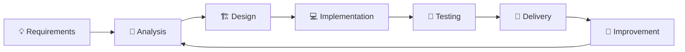

<div align="center">


<br/>

<a href="https://git.io/typing-svg">

</a>

<br/><br/>

<a href="https://github.com/WaelAlSyaidkhalil">

</a>
<a href="mailto:waell.ite.sy@gmail.com">

</a>
<a href="https://www.linkedin.com/in/wael-alsyed-khalil/">

</a>

<br/><br/>


</div>

---

<div align="center">

## 🧠 My Engineering Mindset

**Understand → Analyze → Design → Build → Test → Improve**

> I am interested in turning software requirements into reliable, maintainable and practical systems,
> with a particular focus on backend development, architecture, testing and performance.

</div>

---

## 👨‍💻 About Me

<table>
<tr>
<td width="60%" valign="top">

### Hi, I'm Wael 👋

I am a **5th-year Software Engineering & Information Systems student** at the **Faculty of Information Engineering, Damascus University**.

My main professional interest is **backend and web development**, especially building reliable systems and APIs with the Laravel ecosystem. I also enjoy exploring software architecture, testing, performance, concurrency and cybersecurity concepts.

I like working across the full development lifecycle:

- 🔎 Requirements analysis
- 🏗️ System and software design
- 💻 Backend implementation
- 🌐 API development
- 🧪 Testing and quality
- ⚡ Performance optimization
- 🔧 Debugging and continuous improvement

</td>

<td width="40%" valign="top">

### ⚡ Quick Snapshot

```text
🎓 Education
Software Engineering & Information Systems

🏫 University
Damascus University

📚 Current Level
5th Year

💻 Main Focus
Backend & Web Development

🚀 Main Ecosystem
Laravel / PHP

🧪 Interests
Testing • Architecture • Performance

🔐 Additional Interest
Cybersecurity
```

</td>
</tr>
</table>

---

## 🛠️ Technology Stack

### 💻 Programming Languages

<div align="center">


</div>

> This list includes technologies used in coursework and projects; it does not imply equal proficiency in every technology.

### 🌐 Web & Backend

<div align="center">


</div>

### 🗄️ Databases & Backend Infrastructure

<div align="center">


</div>

### 🔧 Tools & Workflow

<div align="center">


</div>

---

## 🧩 Engineering Interests

<div align="center">

<table>
<tr>
<td align="center" width="25%">

### 🌐 Backend

REST APIs  
Laravel / PHP  
Eloquent ORM  
Queues & Broadcasting

</td>
<td align="center" width="25%">

### 🏗️ Architecture

Clean Architecture  
Layered Design  
MVVM  
Separation of Concerns

</td>
<td align="center" width="25%">

### 🧪 Quality

Software Testing  
API Testing  
Test Cases  
Debugging

</td>
<td align="center" width="25%">

### ⚡ Systems

Concurrency  
Caching  
Async Processing  
Performance

</td>
</tr>
</table>

</div>

---

## 🔐 Cybersecurity Interest

Cybersecurity is one of my technical interests, alongside software development. My background includes introductory cybersecurity study, and I am interested in understanding how software systems can be designed with stronger security foundations.

**Areas of interest:**

`Cybersecurity Fundamentals` `Networks` `Secure Software` `System Security`

---

## 📚 Learning Background

- **Laravel Course**
- **GitHub Course**
- **C++ Programming & OOP Courses**
- **SQL Server Course**
- **English Language Courses**

The courses listed above include learning through online platforms, YouTube, and English Island Institute.

---

## 🚀 Selected Projects

### 🛒 High-Performance E-Commerce Backend Engine

A high-performance backend project designed around concurrent requests, data integrity, asynchronous processing, caching, transactions and resource management.

**Technologies / Concepts**

`Java` `Spring Boot` `Redis` `JPA / Hibernate` `AOP` `Concurrency` `Transactions` `Async Processing` `Thread Pools`

---

### 🏫 School Management System — Darb Al-Ibdaa Private School

A school management system developed for Darb Al-Ibdaa Private School.

**Technologies**

`PHP` `Laravel` `Firebase`

---

### 🍽️ Restaurant Management System

A restaurant management system developed with Laravel.

**Technologies**

`PHP` `Laravel`

---

### 🎨 PixelLab — Interactive Color Laboratory

An interactive WPF application for digital image processing and exploration of RGB, HSV, CMYK, YUV, LAB and YCbCr color spaces, including color adjustment, quantization, pixel analysis and 3D visualization.

**Technologies / Concepts**

`C#` `.NET` `WPF` `MVVM` `Image Processing` `3D Visualization`

---

### 🧵 Java Concurrency & Parallel Processing

Practical Java examples covering concurrency and parallel-processing concepts such as batch processing, thread pools, race conditions, thread safety and real-time processing.

**Focus**

`Concurrency` `Parallel Processing` `Thread Pools` `Thread Safety` `Race Conditions` `Batch Processing`

---

### 🧪 Software Engineering & Testing

Academic software engineering work focused on requirements analysis, software design, implementation, testing and quality assurance.

**Focus**

`Software Engineering II` `Software Testing` `API Testing` `Test Cases` `Quality Assurance`

---

## 📊 GitHub Statistics

<div align="center">


<br/><br/>


</div>

---

## 📈 Contribution Activity

<div align="center">


</div>

---

## 🐍 Contribution Snake

<div align="center">


</div>

> The snake requires a GitHub Actions workflow in the profile repository to generate the SVG.

---

## 🎯 Current Direction

<div align="center">

```text
╭────────────────────────────────────────────────────────────╮
│                                                            │
│  🌐 Build robust backend systems and REST APIs              │
│  🏗️ Improve software architecture and clean code            │
│  🧪 Strengthen testing and software quality                  │
│  ⚡ Explore concurrency and high-performance systems         │
│  🔐 Expand cybersecurity knowledge                            │
│  📱 Continue developing practical applications               │
│                                                            │
╰────────────────────────────────────────────────────────────╯
```

</div>

---

## 🧭 My Development Workflow

<div align="center">



</div>

---

## 🌍 Languages

<div align="center">

| Language | |
|---|---|
| 🇸🇾 Arabic | Native |
| 🇬🇧 English | Learning / Working proficiency |

</div>

---

## 💎 Personal Strengths

<div align="center">

`Problem Solving` · `Critical Thinking` · `Communication` · `Teamwork` · `Time Management`

</div>

---

## 📫 Let's Connect

<div align="center">

<a href="https://github.com/WaelAlSyaidkhalil">

</a>

<a href="mailto:waell.ite.sy@gmail.com">

</a>

<a href="https://www.linkedin.com/in/wael-alsyed-khalil/">

</a>

</div>

---

<div align="center">

### 💭 Build with purpose. Test with discipline. Improve continuously.

<br/>


</div>
